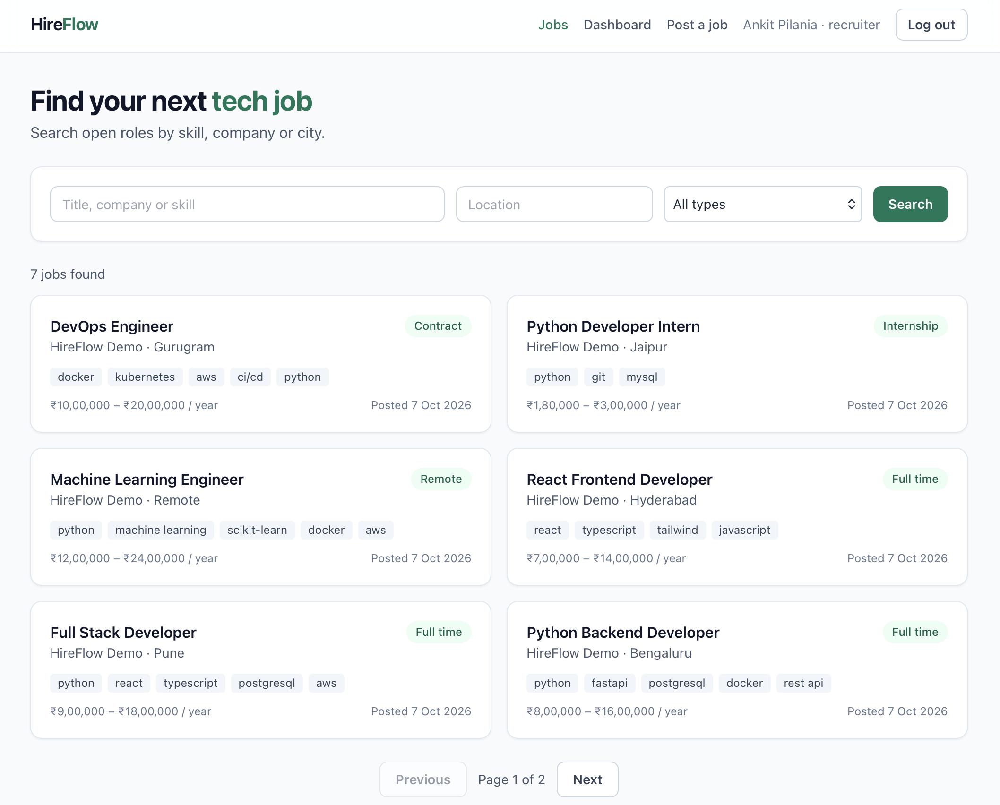
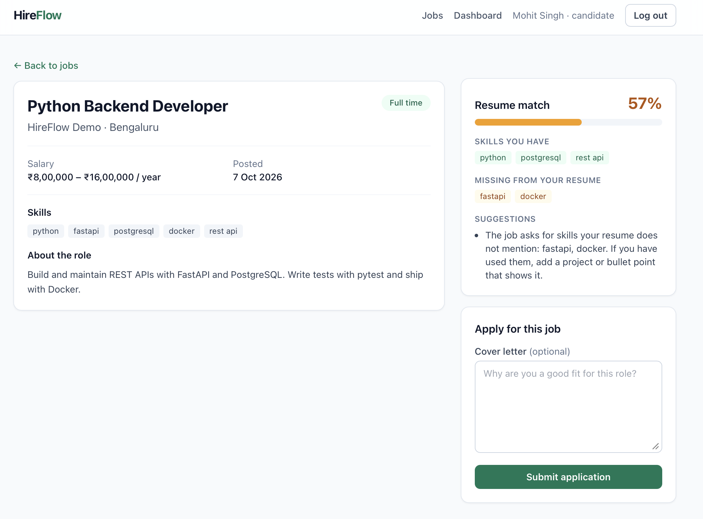
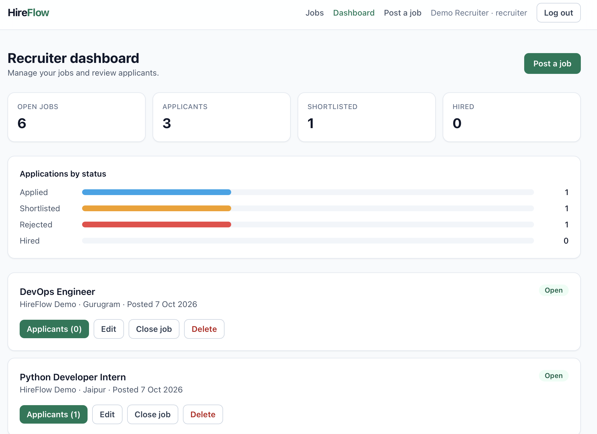
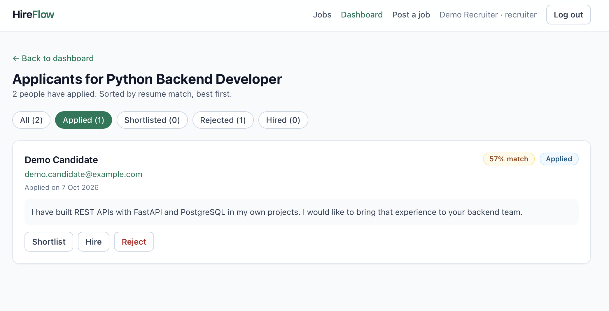

# HireFlow: AI-Powered Job Portal


A full stack job portal where recruiters post jobs and candidates apply. Candidates upload a
resume and get a match score for every job, with the skills they have, the skills they are
missing, and optional AI-written feedback. Recruiters see applicants ranked by that score.

**Live demo:** _add your link here after deployment_

| Demo account | Email | Password |
|---|---|---|
| Recruiter | demo.recruiter@example.com | demo1234 |
| Candidate | demo.candidate@example.com | demo1234 |

## Screenshots

| Job search | Resume match |
|---|---|
|  |  |

| Recruiter dashboard | Applicants ranked by match |
|---|---|
|  |  |

## Features

**Candidates**
- Sign up, search jobs by keyword, location and type, and apply with a cover letter
- Upload a PDF or TXT resume and see a match score for every job
- See matched skills, missing skills and suggestions, plus optional AI feedback
- Track application status on a dashboard and get an email when it changes

**Recruiters**
- Post, edit, close, reopen and delete jobs
- See applicants ranked by resume match score
- Shortlist, hire or reject, with status filters and dashboard stats

## Tech stack

| Layer | Tools |
|---|---|
| Backend | Python, FastAPI, SQLAlchemy 2, Pydantic v2 |
| Auth | JWT (PyJWT), bcrypt password hashing, role-based access |
| Database | PostgreSQL in Docker and production, SQLite for local development |
| AI and matching | Skill matching with synonyms and text similarity in Python, Google Gemini API for feedback, pypdf for resume text |
| Frontend | React 18, TypeScript, Vite, Tailwind CSS, TanStack Query, React Router |
| Testing | pytest, FastAPI TestClient (30 tests) |
| DevOps | Docker Compose, GitHub Actions CI |

## How the match score works

`backend/app/matching.py` scores a resume against a job without any API key:

- **70%** is skill coverage: how many of the job's skills appear in the resume. Matching is by
  whole word, so "java" does not match "javascript", and it understands synonyms such as
  Postgres = PostgreSQL and ReactJS = React.
- **30%** is text similarity: cosine similarity between the words of the resume and the job post.

It is a simple, explainable heuristic rather than a trained model. When a `GEMINI_API_KEY` is
set, candidates can also request written feedback generated by Gemini from the resume and job.

## Run locally

You need Python 3.10 or newer and Node 18 or newer.

**Backend**

```bash
cd backend
python3 -m venv .venv
source .venv/bin/activate        # Windows: .venv\Scripts\activate
pip install -r requirements.txt
cp .env.example .env
python -m app.seed               # optional: adds the demo accounts and 6 jobs
uvicorn app.main:app --reload
```

API docs: http://localhost:8000/docs

**Frontend** (in a second terminal)

```bash
cd frontend
npm install
cp .env.example .env
npm run dev
```

App: http://localhost:5173

**Or with Docker** (PostgreSQL, API and frontend together)

```bash
docker compose up --build
```

## Tests

```bash
cd backend
pytest -v
```

The tests cover auth, role permissions, job search, applications, resume upload, match scoring,
applicant ranking and email notifications. GitHub Actions runs them on every push.

## Project structure

```
backend/
  app/
    main.py            app setup and routers
    models.py          User, Job, Application, Resume tables
    schemas.py         request and response validation
    security.py        password hashing and JWT
    deps.py            current user and role checks
    matching.py        resume-to-job match score
    resume_parser.py   text extraction from PDF and TXT
    ai.py              optional Gemini feedback
    notifications.py   status-change emails as background tasks
    seed.py            demo data
    routers/           auth, jobs, applications, resume
  tests/               pytest suite
frontend/
  src/
    api/               typed fetch client and API calls
    context/           auth state
    components/        Navbar, JobCard, MatchCard, ResumeCard, charts
    pages/             jobs, job detail, dashboards, applicants, login
docker-compose.yml
.github/workflows/ci.yml
```

## Possible next steps

- Alembic migrations in place of creating tables on startup
- Embedding-based semantic matching with pgvector
- Forgot-password flow by email
- Resume file storage on S3

## Author

Ankit Pilania · [GitHub](https://github.com/Ankey02)
